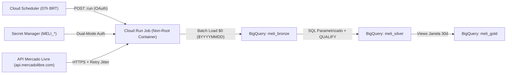

# Pipeline ETL Serverless — Monitoramento Mercado Livre (MLB) no GCP

Pipeline de Engenharia de Dados ponta a ponta construido em **Python 3.12**, **Google BigQuery** (Arquitetura Medalhao: **Bronze / Silver / Gold**), **Secret Manager**, **Artifact Registry**, **Cloud Run Jobs** e **Cloud Scheduler**.

Projetado com foco em **FinOps**, **idempotencia diaria**, **principio do menor privilegio (IAM)** e **resiliencia de API** para execucao serverless em **`southamerica-east1`**.

---

## 1. Arquitetura Geral



### Destaques de Engenharia

* **Conector Dual-Mode (`src/auth.py` & `src/meli_client.py`):**
  * **`OAUTH_MODE`:** Renovacao automatica via `POST /oauth/token`, rotacao atomica do `refresh_token` *single-use* no Secret Manager (destruindo versoes antigas), busca de `/highlights` + `/search` e enriquecimento via Multiget em lotes de ate `20` IDs (`/items?ids=...`).
  * **`PUBLIC_MODE` (Fallback resiliente):** Quando credenciais OAuth ainda nao estao configuradas (`MELI_APP_ID=PUBLIC_MODE`), coleta automaticamente arvores de macro-categorias (`/categories/{id}`), descoberta semantica (`/sites/MLB/domain_discovery/search`) e especificacoes/atributos de nichos folha (`/categories/{id}/attributes`).
* **Ingestao Bronze Idempotente a Custo Zero (`src/bronze_loader.py`):**
  * Utiliza **BigQuery Batch Load Jobs** (`load_table_from_json` em NDJSON) com *partition decorator* `$YYYYMMDD` e `WRITE_TRUNCATE`.
  * Reexecucoes no mesmo dia substituem apenas a particao alvo sem duplicar registros e sem usar *Streaming Inserts* pagos.
  * Schema explicito (`BRONZE_SCHEMA`) com `autodetect=False`, preservando `raw_payload` como tipo nativo `JSON NOT NULL`.
* **Camada Silver Transacional & Deduplicada (`src/silver_transformer.py`):**
  * Executa scripts SQL parametrizados (`@execution_date`) dentro de transacao atomica (`BEGIN TRANSACTION; DELETE ...; INSERT ...; COMMIT TRANSACTION;`), evitando conflitos de relaxamento `REQUIRED -> NULLABLE`.
  * Aplica `QUALIFY ROW_NUMBER() OVER (...) = 1` nas 3 tabelas Silver (`dim_categories`, `fact_daily_item_prices`, `fact_daily_trends`).
* **Camada Gold Pronta para BI (`sql/03_gold_views.sql`):**
  * `vw_price_monitoring`: precos, descontos, volume de ofertas, adocao de catalogo e exigencia de GTIN por categoria/nicho.
  * `vw_logistics_share`: distribuicao por modalidade logistica (`fulfillment`, `carrier`, `custom`) e cobertura de frete gratis.
  * `vw_trends_vs_offers`: cruzamento entre termos monitorados, marca/modelo inferidos, concorrencia ativa e indice de oportunidade.

---

## 2. Governanca, Seguranca & FinOps

| Pilar | Controle Implementado |
| :--- | :--- |
| **Particionamento & Custos** | `PARTITION BY execution_date` / `snapshot_date`, `CLUSTER BY category_id`, `require_partition_filter = TRUE` em Bronze/Silver, expiracao automatica de `90` dias na Bronze e views Gold com janela deslizante de `30` dias. |
| **Trava de Leitura SQL** | `maximum_bytes_billed = 52428800` (`50 MiB`) em todas as transformacoes Silver (abortando queries fora do orcamento antes da cobranca). |
| **Container Hardening** | `Dockerfile` multi-stage (`python:3.12-slim` + `uv 0.12.23`) executando sob usuario non-root (`USER 10001:10001`); `.dockerignore` bloqueia `.env`, `.git/`, `.venv/` e `*.json`. |
| **IAM Menor Privilegio** | Service Account dedicada (`sa-etl-meli`) com `roles/bigquery.jobUser`, permissao `WRITER` restrita aos datasets `meli_bronze`/`meli_silver`, acesso granular por segredo no Secret Manager e `roles/run.invoker` apenas no job alvo. |
| **Artifact Registry** | Politica de retencao automatica mantendo apenas as `2` versoes mais recentes (`keepCount: 2`) e removendo digests *untagged* apos `24h`. |

---

## 3. Estrutura do Repositorio

```text
.
|-- config/
|   `-- categories.yaml          # Categorias MLB alvo e queries monitoradas
|-- sql/
|   |-- 01_bronze_ddl.sql        # DDL particionada/clusterizada (meli_bronze)
|   |-- 02_silver_ddl.sql        # DDL tipada dual-mode (meli_silver)
|   |-- 03_gold_views.sql        # Views analiticas Gold (janela 30d)
|   `-- transforms/              # Scripts SQL parametrizados Bronze -> Silver
|-- src/
|   |-- auth.py                  # Dual-Mode Auth + rotacao no Secret Manager
|   |-- meli_client.py           # Cliente HTTP resiliente (Retry + Full Jitter)
|   |-- bronze_loader.py         # Batch Loader $0 com overwrite por particao
|   |-- silver_transformer.py    # Executor SQL transacional com trava FinOps
|   `-- main.py                  # Orquestrador CLI (--execution-date, --skip-extract)
|-- tests/                       # Testes unitarios (unittest + mocks)
|-- .dockerignore
|-- .env.example
|-- Dockerfile
`-- pyproject.toml
```

---

## 4. Setup Local, Testes e Execucao

### Pre-requisitos
* Python 3.12+ e `uv`
* Google Cloud SDK (`gcloud` e `bq`) autenticado via ADC (`gcloud auth application-default login`)

### Instalacao e Testes Unitarios

```powershell
cp .env.example .env
# Preencha GCP_PROJECT_ID no arquivo .env (nao versionado)

uv sync
uv run python -m unittest discover -s tests -v
```

### Aplicar DDLs e Views no BigQuery

```powershell
$PROJECT_ID = "seu-projeto-gcp"

Get-Content "sql\01_bronze_ddl.sql" -Raw | bq query --project_id=$PROJECT_ID --location=southamerica-east1 --use_legacy_sql=false
Get-Content "sql\02_silver_ddl.sql" -Raw | bq query --project_id=$PROJECT_ID --location=southamerica-east1 --use_legacy_sql=false
Get-Content "sql\03_gold_views.sql" -Raw | bq query --project_id=$PROJECT_ID --location=southamerica-east1 --use_legacy_sql=false
```

### Executar o Pipeline Localmente

```powershell
# Execucao completa (Extract -> Bronze -> Silver) para a data UTC atual
uv run python -m src.main

# Reprocessar apenas Silver de uma data especifica (backfill idempotente)
uv run python -m src.main --execution-date 2026-11-15 --skip-extract
```

---

## 5. Deploy Serverless no GCP (`southamerica-east1`)

```powershell
$PROJECT_ID = "seu-projeto-gcp"
$REGION     = "southamerica-east1"
$REPO       = "etl-meli"
$IMAGE      = "$REGION-docker.pkg.dev/$PROJECT_ID/$REPO/etl-meli-job:v1"
$SA_EMAIL   = "sa-etl-meli@$PROJECT_ID.iam.gserviceaccount.com"

# 1. Build remoto via Cloud Build
gcloud builds submit --project=$PROJECT_ID --tag=$IMAGE .

# 2. Deploy do Cloud Run Job (colocalizado com o BigQuery em southamerica-east1)
gcloud run jobs deploy etl-meli-job `
  --project=$PROJECT_ID `
  --region=$REGION `
  --image=$IMAGE `
  --service-account=$SA_EMAIL `
  --cpu=1 `
  --memory=512Mi `
  --max-retries=1 `
  --task-timeout=300s `
  --set-env-vars="GCP_PROJECT_ID=$PROJECT_ID,BQ_LOCATION=$REGION,BQ_DATASET_BRONZE=meli_bronze,BQ_DATASET_SILVER=meli_silver,BQ_MAX_BYTES_BILLED=52428800"

# 3. Disparo manual validado
gcloud run jobs execute etl-meli-job --project=$PROJECT_ID --region=$REGION --wait
```
